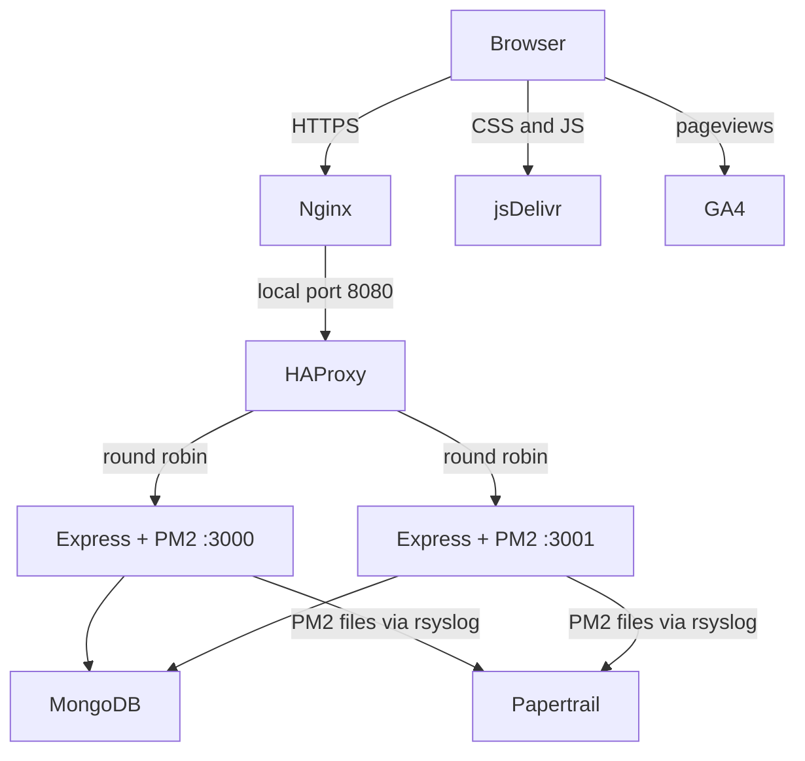

# LinkLocker
This is a URL Shortner, users enter a long URL, generate a shorter link, and redirect visitors to the original URL.

https://linklocker.northcentralus.cloudapp.azure.com/

## Milestones

- **[Milestone A COMPLETED](MILESTONE%20A/README.md)**
- **[Milestone B COMPLETED](MILESTONE%20B/writeup.md)**
---
- **[Milestone C COMPLETED](MILESTONE%20C/writeup.md)** — [deployment guide](MILESTONE%20C/DEPLOYMENT.md), [annotated HAProxy config](MILESTONE%20C/haproxy.cfg), [Nginx config](MILESTONE%20C/nginx.conf), and linked GA4/Papertrail evidence.

## Tech

HTML, CSS, JavaScript, Node.js, Express, MongoDB, Azure VM, PM2, Nginx, HAProxy, jsDelivr, Papertrail, and GA4. TLS certificate by Let's Encrypt.

## Architecture

Nginx, HAProxy, and both PM2 workers currently run on the same Azure VM. The two workers can survive an individual process failure; the VM remains a single point of failure. See the [Milestone C write-up](MILESTONE%20C/writeup.md) for the proposed two-VM design.

## Team Contributions

### Milestone A

**@ShervinBabaei2007 Application Development**
- Built the LinkLocker app, its frontend and Express backend
- URL shortening and MongoDB

**@fa-nebusoku Infrastructure + Deployment**
- Connected the app to an external MongoDB
- Set up and config azure vm
- Configure nginx as a reverse proxy + enabled HTTPS
- PM2
- Milestone A writeup and evidence

---

### Milestone B

**@ShervinBabaei2007 Authentication Development**
- implement google OAuth w/ passport.js.
- Added auth related backend routes, user sessions, and login protected link creation.
- link auth with the Express app
- Registration of the prod OAuth callback
- Milestone B writeup

**@fa-nebusoku**
- Registration of the prod OAuth callback
- Configure the prod .env variables for Google OAuth
- Fix frontend bugs and what it displays

---

### Milestone C

**@sawyer100 — infrastructure and verification**
- Set up and tested two PM2 workers behind HAProxy on the Azure VM, including health checks and a one-worker failover test.
- Connected Nginx to HAProxy, checked jsDelivr asset delivery, configured GA4, and tested Google login and short-link creation on the live site.

**@ShervinBabaei2007 — logging and documentation**
- Set up Papertrail collection for both PM2 workers and verified their startup logs in one view.
- Prepared the Milestone C documentation and evidence for team review.
